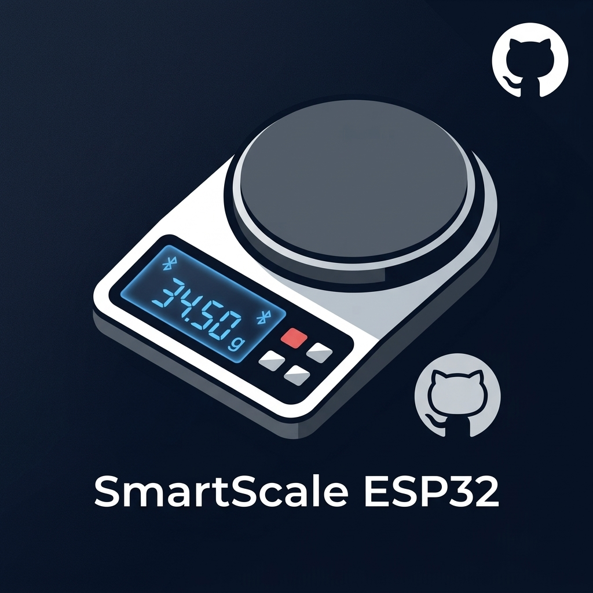
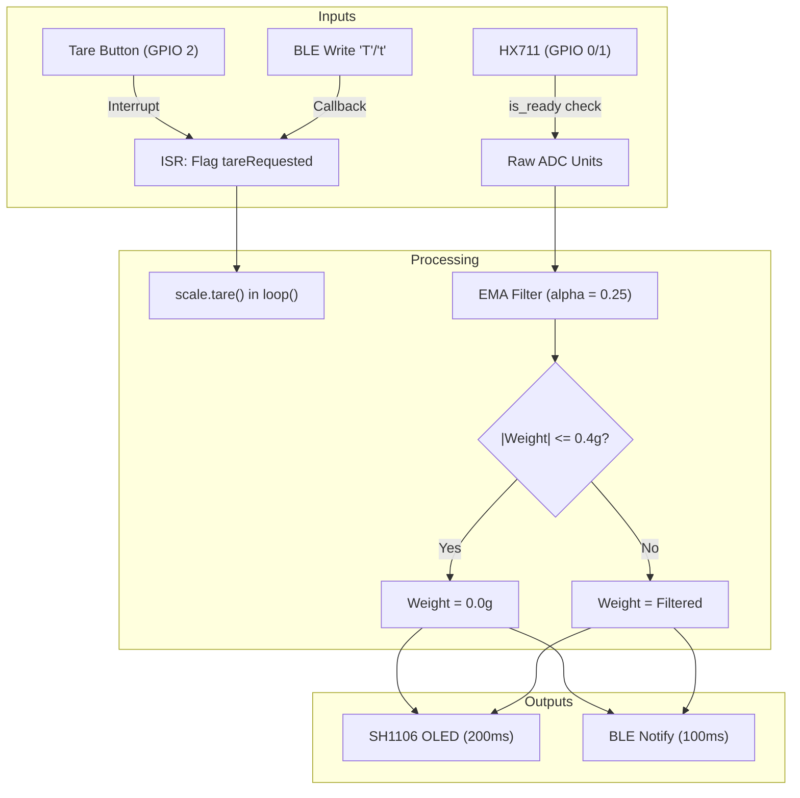

<p align="center">
  
</p>

<h1 align="center">Smart Kitchen Scale Firmware</h1>

<p align="center">
  Non-blocking firmware for ESP32-C3 Super Mini smart kitchen scales with HX711 load cell sensing, SH1106 OLED display, and BLE GATT connectivity.
</p>

<p align="center">
  <a href="https://github.com/AtaCanYmc/SmartcaleESP32/actions/workflows/ci.yml"></a>
  <a href="https://platformio.org"></a>
  <a href="https://www.espressif.com"></a>
  <a href="LICENSE"></a>
</p>

---

## Table of Contents

- [Overview](#overview)
- [Technical Documentation (`docs/`)](#technical-documentation)
- [Hardware Specifications](#hardware-specifications)
- [Pin Configuration](#pin-configuration)
- [System Architecture](#system-architecture)
- [Wi-Fi Provisioning & Web Portal](#wi-fi-provisioning--web-portal)
- [BLE GATT Specification](#ble-gatt-specification)
- [Quick Start](#quick-start)
- [Configuration & Calibration](#configuration--calibration)
- [Repository Structure](#repository-structure)
- [Technical FAQ](#technical-faq)
- [License](#license)

---

## Overview

This repository contains the production firmware for a digital kitchen scale built around the ESP32-C3 Super Mini development board. The system executes non-blocking measurement, filtering, display rendering, and BLE telemetry without relying on blocking delays or complex RTOS thread synchronization.

### Key Capabilities

- **Wi-Fi Provisioning & Captive Portal**: Broadcasts SoftAP (`SmartScale-Setup`) with automatic DNS captive portal on first boot or button hold, enabling mobile-friendly configuration of Wi-Fi network, BLE device name, and calibration factor.
- **Non-blocking Dispatch Loop**: Driven entirely by `millis()` interval registers, maintaining responsive 100ms BLE updates and 200ms display frame rates.
- **Hardware Interrupt Tare**: Falling-edge interrupt on GPIO 2 with 200ms hardware-debounced flag assertion.
- **Noise Filtration & Deadband**: Exponential Moving Average (EMA, alpha = 0.25) combined with a +/- 0.4g zero-point deadband to suppress idle mechanical jitter.

---

## Technical Documentation

Detailed engineering guides and architectural specifications are organized in the [`docs/`](docs/) directory:

| Guide | Description |
| :--- | :--- |
| [Hardware Specification](docs/hardware.md) | Pin assignments, wiring diagrams, load cell interfaces, and power circuits |
| [Firmware Architecture](docs/architecture.md) | Non-blocking scheduling loop, interrupt handlers, EMA filter, and Li-Po piecewise model |
| [BLE GATT Specification](docs/ble_protocol.md) | Service UUIDs, characteristic descriptors, notification payloads, and command sequences |
| [Wi-Fi Provisioning & Portal](docs/provisioning.md) | Captive portal DNS hijacking, HTTP endpoints, and NVS storage layout |
| [Calibration & Troubleshooting](docs/calibration.md) | Mathematical formulas, physical calibration procedure, and troubleshooting matrix |

---

## Hardware Specifications

| Component | Model / Type | Interface |
| :--- | :--- | :--- |
| Microcontroller | ESP32 Super Mini (ESP32-C3 RISC-V @ 160MHz) | Native USB CDC / JTAG |
| Load Cell ADC | HX711 24-bit Analog-to-Digital Converter | 2-Wire Bit-Banged Serial |
| Display | 1.3-inch 128x64 Monochrome OLED (SH1106) | Hardware I2C (400kHz) |
| User Input | Push Button (Tactile Switch) | Internal Pull-Up, Active Low |

---

## Pin Configuration

| Peripheral | Signal | ESP32-C3 GPIO | Electrical Configuration |
| :--- | :--- | :--- | :--- |
| **HX711** | DT (Data) | GPIO 0 | Input |
| **HX711** | SCK (Clock) | GPIO 1 | Output |
| **Tare Button** | Signal | GPIO 2 | `INPUT_PULLUP` to GND |
| **OLED (SH1106)** | SDA | GPIO 8 | Hardware I2C Data |
| **OLED (SH1106)** | SCL | GPIO 9 | Hardware I2C Clock |

For detailed electrical schematics, component ratings, and subsystem hookups, see [Hardware Specification](docs/hardware.md).

---

## System Architecture

The firmware processes sensor telemetry, peripheral updates, and client communications in an asynchronous state loop:



For full state machines, interrupt debouncing, and digital filter equations, see [Firmware Architecture](docs/architecture.md).

---

## Wi-Fi Provisioning & Web Portal

The scale features an integrated SoftAP with an auto-redirecting DNS captive portal, allowing users to configure settings from any phone or computer browser without extra software.

### Activation Triggers

1. **First Boot (Automatic)**: If no Wi-Fi credentials are saved in NVS storage, the device immediately launches the setup portal.
2. **Manual Override**: Holding the Tare button (GPIO 2) during power-on for more than 2 seconds forces the setup portal.

### Network & Portal Information

| Parameter | Value |
| :--- | :--- |
| **Setup Wi-Fi SSID** | `SmartScale-Setup` (Open network, no password) |
| **Portal IP Address** | `192.168.4.1` |
| **Captive Redirection** | Automatic on iOS, Android, macOS, and Windows |
| **OLED Status** | Displays SSID and IP during setup |

### Configurable Settings

- **Wi-Fi Network (SSID)**: Interactive drop-down with live-scanned networks or manual text entry.
- **Wi-Fi Password**: WPA2/WPA3 network passphrase.
- **BLE Device Name**: Custom name for Bluetooth identification (defaults to `SmartKitchenScale`).
- **Calibration Factor**: Direct adjustment of the load cell scaling ratio.
- **Factory Reset**: Single-click button to wipe NVS storage and restore hardware defaults.

For complete DNS hijacking mechanisms, captive probe routes, and NVS storage layout, see [Wi-Fi Provisioning & Captive Portal](docs/provisioning.md).

---

## BLE GATT Specification

The ESP32 acts as a GATT Server advertising under the local name defined in configuration (default: `SmartKitchenScale`).

### Service: Scale Service
- **UUID**: `4fafc201-1fb5-459e-8fcc-c5c9c331914b`

### Characteristics

| Characteristic | UUID | Properties | Format / Payload | Description |
| :--- | :--- | :--- | :--- | :--- |
| **Weight Data** | `beb5483e-36e1-4688-b7f5-ea07361b26a8` | Read, Notify | UTF-8 String (e.g. `"125.4"`) | Pushed every 100ms when connected |
| **Remote Command**| `1c95d5e3-d8f7-413a-bf3d-7a2e5d7be87e` | Write | UTF-8 Char (`'T'` or `'t'`) | Triggers tare operation on write |

For complete packet formats, CCCD subscription requirements, and sequence diagrams, see [BLE GATT Specification](docs/ble_protocol.md).

---

## Quick Start

### Prerequisites

- [PlatformIO Core CLI](https://docs.platformio.org/en/latest/core/installation/index.html) or PlatformIO IDE extension for VS Code / CLion.
- USB-C cable connected to the ESP32-C3 Super Mini.

### 1. Build Firmware

Compile the firmware binary and download library dependencies:

```bash
pio run
```

### 2. Flash to Device

Connect the board and flash the target environment:

```bash
pio run --target upload
```

### 3. Open Serial Monitor

Monitor diagnostic output over USB CDC:

```bash
pio device monitor --baud 115200
```

---

## Configuration & Calibration

All operational constants and calibration parameters reside in [include/config.h](include/config.h).

### Calibration Procedure

1. Set `CALIBRATION_FACTOR` in `include/config.h` to `1.0f`.
2. Flash the board, place a known reference weight on the platform (e.g. 500.0 grams).
3. Read the displayed raw value via serial console or OLED.
4. Calculate the new factor:
   $$\text{Calibration Factor} = \frac{\text{Raw Reading}}{\text{Known Weight in Grams}}$$
5. Update `CALIBRATION_FACTOR` in `include/config.h` and reflash the device.

For runtime web portal calibration, mathematical derivations, and a full troubleshooting matrix, see [Calibration & Troubleshooting](docs/calibration.md).

---

## Repository Structure

```
SmartcaleESP32/
├── .github/
│   └── workflows/
│       └── ci.yml          # Automated PlatformIO build verification
├── assets/
│   └── logo.jpg            # Repository brand emblem
├── docs/                   # In-depth technical documentation suite
│   ├── README.md           # Documentation index and subsystem map
│   ├── architecture.md     # Software scheduling and signal processing filters
│   ├── ble_protocol.md     # BLE GATT service and characteristic specification
│   ├── calibration.md      # Load cell calibration protocol and diagnosis
│   ├── hardware.md         # Electrical schematics, pin mapping, and peripherals
│   └── provisioning.md     # SoftAP captive portal and NVS configuration
├── include/
│   ├── ble_scale.h         # BLE GATT server, advertising, and characteristic callbacks
│   ├── config.h            # Pin definitions, calibration factor, and timing constants
│   ├── display.h           # SH1106 OLED rendering graphics
│   ├── portal.h            # Captive portal DNS server and mobile web configurator
│   └── storage.h           # NVS Preferences manager for persistent parameters
├── src/
│   └── main.cpp            # Main entry point, interrupt handlers, and scheduling loop
├── .gitignore              # Build artifact exclusions (.pio, .vscode)
├── CONTRIBUTING.md         # Commit standards and pull request validation rules
├── LICENSE                 # MIT License terms
├── platformio.ini          # Board definitions, build flags, and library dependencies
├── README.md               # Primary technical documentation
├── ROADMAP.md              # Milestone tracking and planned features
└── SECURITY.md             # Vulnerability disclosure policy and response SLA
```

---

## Technical FAQ

#### Why use non-blocking polling on `scale.is_ready()` instead of FreeRTOS tasks?
HX711 outputs data at a fixed 10Hz or 80Hz rate determined by its pin configuration. Polling `is_ready()` without blocking lets the main thread update the OLED display and service BLE stacks continuously. This avoids the memory overhead and context switching of dedicated FreeRTOS task stacks on the memory-constrained ESP32-C3.

---

## License

This project is licensed under the terms of the [MIT License](LICENSE).
