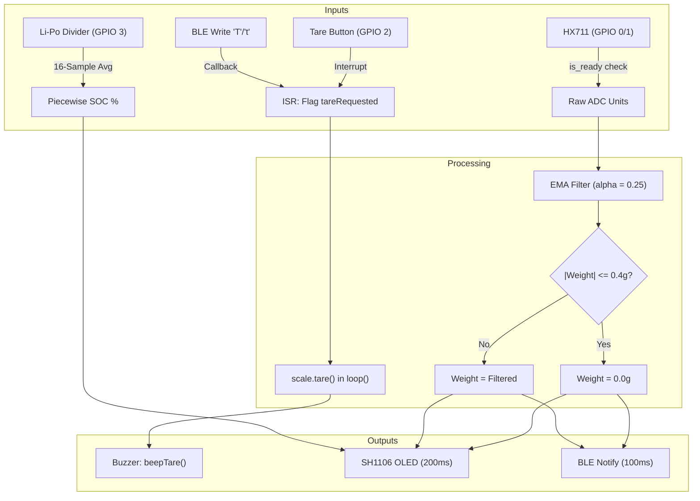

# Smart Kitchen Scale Firmware

Non-blocking firmware for ESP32-C3 Super Mini smart kitchen scales with HX711 load cell sensing, SH1106 OLED display, Li-Po battery fuel gauge, and BLE GATT connectivity.

[](https://github.com/AtaCanYmc/SmartcaleESP32/actions/workflows/ci.yml)
[](https://platformio.org)
[](https://www.espressif.com)
[](LICENSE)

---

## Table of Contents

- [Overview](#overview)
- [Hardware Specifications](#hardware-specifications)
- [Pin Configuration](#pin-configuration)
- [System Architecture](#system-architecture)
- [BLE GATT Specification](#ble-gatt-specification)
- [Quick Start](#quick-start)
- [Configuration & Calibration](#configuration--calibration)
- [Repository Structure](#repository-structure)
- [Technical FAQ](#technical-faq)
- [License](#license)

---

## Overview

This repository contains the production firmware for a digital kitchen scale built around the ESP32-C3 Super Mini development board. The system executes non-blocking measurement, filtering, display rendering, acoustic notifications, and BLE telemetry without relying on blocking delays or complex RTOS thread synchronization.

### Key Capabilities

- **Non-blocking Dispatch Loop**: Driven entirely by `millis()` interval registers, maintaining responsive 100ms BLE updates and 200ms display frame rates.
- **Hardware Interrupt Tare**: Falling-edge interrupt on GPIO 2 with 200ms hardware-debounced flag assertion.
- **Noise Filtration & Deadband**: Exponential Moving Average (EMA, alpha = 0.25) combined with a +/- 0.4g zero-point deadband to suppress idle mechanical jitter.
- **Piecewise Li-Po Fuel Gauge**: 11-point piecewise linear interpolation across standard 1S lithium polymer discharge curves using eFuse-calibrated ADC millivolt readings.
- **Acoustic Feedback**: Hardware LEDC PWM tone generation on GPIO 4 for boot, tare confirmation, and BLE connection state transitions.

---

## Hardware Specifications

| Component | Model / Type | Interface |
| :--- | :--- | :--- |
| Microcontroller | ESP32 Super Mini (ESP32-C3 RISC-V @ 160MHz) | Native USB CDC / JTAG |
| Load Cell ADC | HX711 24-bit Analog-to-Digital Converter | 2-Wire Bit-Banged Serial |
| Display | 1.3-inch 128x64 Monochrome OLED (SH1106) | Hardware I2C (400kHz) |
| Audio Indicator | Passive / Active Piezo Buzzer | Hardware LEDC PWM Tone |
| User Input | Push Button (Tactile Switch) | Internal Pull-Up, Active Low |
| Battery Sense | 1S Li-Po (3.7V nominal, 4.2V max) | 100k + 100k Voltage Divider |

---

## Pin Configuration

| Peripheral | Signal | ESP32-C3 GPIO | Electrical Configuration |
| :--- | :--- | :--- | :--- |
| **HX711** | DT (Data) | GPIO 0 | Input |
| **HX711** | SCK (Clock) | GPIO 1 | Output |
| **Tare Button** | Signal | GPIO 2 | `INPUT_PULLUP` to GND |
| **Battery Monitor**| ADC Input | GPIO 3 (ADC1_CH3) | 11dB attenuation, 2.0x divider |
| **Piezo Buzzer** | PWM | GPIO 4 | Push-Pull Output |
| **OLED (SH1106)** | SDA | GPIO 8 | Hardware I2C Data |
| **OLED (SH1106)** | SCL | GPIO 9 | Hardware I2C Clock |

---

## System Architecture

The firmware processes sensor telemetry, peripheral updates, and client communications in an asynchronous state loop:



---

## BLE GATT Specification

The ESP32 acts as a GATT Server advertising under the local name `SmartKitchenScale`.

### Service: Scale Service
- **UUID**: `4fafc201-1fb5-459e-8fcc-c5c9c331914b`

### Characteristics

| Characteristic | UUID | Properties | Format / Payload | Description |
| :--- | :--- | :--- | :--- | :--- |
| **Weight Data** | `beb5483e-36e1-4688-b7f5-ea07361b26a8` | Read, Notify | UTF-8 String (e.g. `"125.4"`) | Pushed every 100ms when connected |
| **Remote Command**| `1c95d5e3-d8f7-413a-bf3d-7a2e5d7be87e` | Write | UTF-8 Char (`'T'` or `'t'`) | Triggers tare operation on write |

---

## Quick Start

### Prerequisites

- [PlatformIO Core CLI](https://docs.platformio.org/en/latest/core/installation/index.html) or PlatformIO IDE extension for VS Code / CLion.
- USB-C cable connected to the ESP32-C3 Super Mini.

### 1. Build Firmware

Compile the firmware binary and download library dependencies:

```bash
pio run
```

### 2. Flash to Device

Connect the board and flash the target environment:

```bash
pio run --target upload
```

### 3. Open Serial Monitor

Monitor diagnostic output over USB CDC:

```bash
pio device monitor --baud 115200
```

---

## Configuration & Calibration

All operational constants and calibration parameters reside in [include/config.h](include/config.h).

### Calibration Procedure

1. Set `CALIBRATION_FACTOR` in `include/config.h` to `1.0f`.
2. Flash the board, place a known reference weight on the platform (e.g. 500.0 grams).
3. Read the displayed raw value via serial console or OLED.
4. Calculate the new factor:
   $$\text{Calibration Factor} = \frac{\text{Raw Reading}}{\text{Known Weight in Grams}}$$
5. Update `CALIBRATION_FACTOR` in `include/config.h` and reflash the device.

---

## Repository Structure

```
SmartcaleESP32/
├── .github/
│   └── workflows/
│       └── ci.yml          # Automated PlatformIO build verification
├── include/
│   ├── battery.h           # ADC sampling and piecewise Li-Po SOC approximation
│   ├── ble_scale.h         # BLE GATT server, advertising, and characteristic callbacks
│   ├── buzzer.h            # Non-blocking acoustic tone feedback
│   ├── config.h            # Pin definitions, calibration factor, and timing constants
│   └── display.h           # SH1106 OLED rendering and battery gauge graphics
├── src/
│   └── main.cpp            # Main entry point, interrupt handlers, and scheduling loop
├── .gitignore              # Build artifact exclusions (.pio, .vscode)
├── CONTRIBUTING.md         # Commit standards and pull request validation rules
├── LICENSE                 # MIT License terms
├── platformio.ini          # Board definitions, build flags, and library dependencies
├── README.md               # Primary technical documentation
├── ROADMAP.md              # Milestone tracking and planned features
└── SECURITY.md             # Vulnerability disclosure policy and response SLA
```

---

## Technical FAQ

#### Why use non-blocking polling on `scale.is_ready()` instead of FreeRTOS tasks?
HX711 outputs data at a fixed 10Hz or 80Hz rate determined by its pin configuration. Polling `is_ready()` without blocking lets the main thread update the OLED display and service BLE stacks continuously. This avoids the memory overhead and context switching of dedicated FreeRTOS task stacks on the memory-constrained ESP32-C3.

#### How does the Li-Po estimation account for non-linear discharge?
Lithium polymer cells spend the majority of their discharge plateau between 3.7V and 3.9V, dropping steeply below 3.6V and above 4.1V. A pure linear map from 3.3V to 4.2V produces inaccurate percentages. The firmware uses an 11-point piecewise linear approximation table calibrated against the real open-circuit voltage curve of 1S Li-Po cells.

#### Does the buzzer block loop execution during sound generation?
No. The `tone()` function in the ESP32 Arduino framework dispatches command packets to an asynchronous FreeRTOS hardware timer task that manages LEDC PWM registers. Execution in `loop()` continues without delay.

---

## License

This project is licensed under the terms of the [MIT License](LICENSE).
