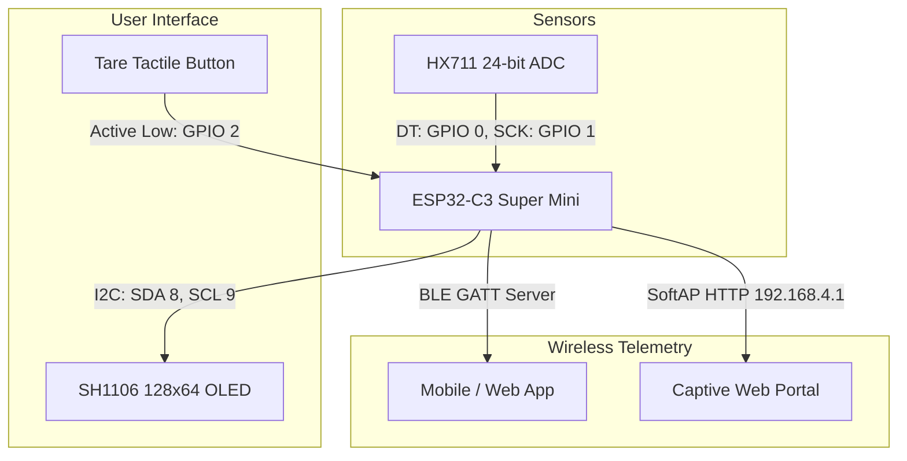

# Technical Documentation Index

[← Back to Root Repository](../README.md)

This directory provides in-depth technical documentation for the SmartcaleESP32 firmware, hardware schematics, communication interfaces, and runtime operation.

---

## Documentation Modules

| Document | Primary Focus | Key Contents |
| :--- | :--- | :--- |
| [Hardware Specification](hardware.md) | Electrical & Wiring | Pin mapping, HX711 wiring, and I2C OLED circuitry |
| [Firmware Architecture](architecture.md) | Software Design & Flow | Non-blocking loop, GPIO interrupts, and EMA filter |
| [BLE GATT Protocol](ble_protocol.md) | Wireless Interface | Service and characteristic UUIDs, notification payloads, tare commands |
| [Provisioning & Web Portal](provisioning.md) | Initial Configuration | SoftAP captive portal, DNS redirection, NVS parameter persistence |
| [Calibration & Troubleshooting](calibration.md) | Sensor Adjustment | Load cell calibration formula, reference mass verification, issue diagnosis |
| [Mock / Simulation Mode](mock_mode.md) | Hardware-Free Testing | Module-less testing, synthetic weight injection, serial control, tare validation |

---

## System Subsystem Topology

The following diagram illustrates the hardware peripherals, core microcontroller interfaces, and external client connections:

---

## Architectural Principles

1. **Non-blocking Execution**: The firmware operates without blocking delay functions. All sensor polling, screen updates, and communication tasks evaluate monotonically increasing millisecond timers.
2. **Deterministic Tare via Hardware Interrupt**: Tare button presses register on a dedicated falling-edge interrupt handler with hardware-debounced validation.
3. **Zero-Configuration SoftAP**: Unconfigured units broadcast an open setup access point with captive DNS redirection on port 53.
