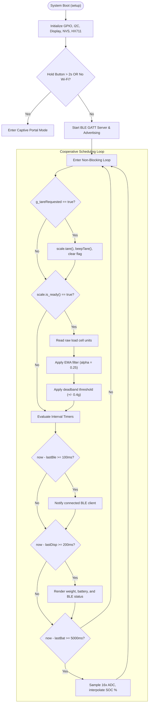

# Firmware Architecture & Timing

[← Back to Documentation Index](README.md) | [← Back to Root Repository](../README.md)

This document describes the firmware architecture, interrupt handling, signal processing filters, and timing schedules implemented in the SmartcaleESP32 codebase.

---

## Architecture Overview

The firmware uses a single-threaded, cooperative scheduling model built on monotonic millisecond timestamps (`millis()`). It avoids FreeRTOS task overhead, critical section locks, and blocking delays in the main execution path.

---

## Core Subsystems

### 1. Interrupt Driven Tare Processing

Tare commands originate from either a physical button press or a remote BLE GATT write operation:

1. **Physical Button Press**: GPIO 2 falling edge triggers `tareISR()`. The ISR validates a 200ms debounce interval against `millis()`. If valid, it asserts the volatile flag `g_tareRequested = true`.
2. **BLE Remote Command**: Writing `'T'` or `'t'` to the command characteristic executes the characteristic callback, which sets `g_tareRequested = true`.
3. **Execution in Main Thread**: The main loop inspects `g_tareRequested`. If set, it executes `scale.tare()`, issues an acoustic confirmation via `beepTare()`, and resets the flag. This keeps hardware bus communication out of interrupt service routines.

### 2. Signal Conditioning and Noise Rejection

Raw analog readings from strain gauges exhibit thermal drift and mechanical vibration. The firmware applies a two-stage filtering pipeline:

#### Exponential Moving Average (EMA)
Each time the HX711 signals data readiness (`scale.is_ready()`), the raw reading updates an exponential moving average register:

$$y_k = \alpha \cdot x_k + (1 - \alpha) \cdot y_{k-1}$$

Where:
- $x_k$ is the current instantaneous weight reading from the ADC.
- $y_{k-1}$ is the prior filtered state.
- $\alpha$ is the smoothing factor set to `0.25` in `include/config.h`.

An alpha of 0.25 suppresses high-frequency sensor noise while responding to significant weight changes in less than 300 milliseconds.

#### Idle Deadband Suppression
Small mechanical vibrations on empty scale platforms cause rapid jumping around zero (+/- 0.2g). If the absolute filtered value falls within the deadband limit, the firmware sets the displayed and transmitted weight to zero:

$$\text{Reported Weight} = \begin{cases} 0.0 & \text{if } |y_k| \le 0.4\,\text{g} \\ y_k & \text{otherwise} \end{cases}$$

### 3. Piecewise Linear Li-Po Battery Estimation

Standard lithium polymer (Li-Po) cells exhibit a flat discharge plateau between 3.7V and 3.9V. Linear interpolation against raw voltage leads to substantial estimation errors.

The firmware samples the battery ADC 16 times in succession to reject power supply ripple. The resulting millivolt reading maps to State of Charge (SOC) using an 11-point piecewise linear curve:

| Battery Voltage ($V_{\text{BAT}}$) | State of Charge (SOC) | Linear Slope ($\Delta\% / \Delta\text{mV}$) |
| :--- | :--- | :--- |
| $\le 3200\,\text{mV}$ | 0% | Cutoff threshold |
| $3200\,\text{mV} - 3600\,\text{mV}$ | 0% - 5% | 0.0125 |
| $3600\,\text{mV} - 3700\,\text{mV}$ | 5% - 10% | 0.0500 |
| $3700\,\text{mV} - 3750\,\text{mV}$ | 10% - 20% | 0.2000 |
| $3750\,\text{mV} - 3790\,\text{mV}$ | 20% - 30% | 0.2500 |
| $3790\,\text{mV} - 3830\,\text{mV}$ | 30% - 40% | 0.2500 |
| $3830\,\text{mV} - 3870\,\text{mV}$ | 40% - 50% | 0.2500 |
| $3870\,\text{mV} - 3920\,\text{mV}$ | 50% - 60% | 0.2000 |
| $3920\,\text{mV} - 3970\,\text{mV}$ | 60% - 70% | 0.2000 |
| $3970\,\text{mV} - 4100\,\text{mV}$ | 70% - 90% | 0.1538 |
| $4100\,\text{mV} - 4200\,\text{mV}$ | 90% - 100% | 0.1000 |
| $\ge 4200\,\text{mV}$ | 100% | Charging saturation |

### 4. Loop Scheduling Intervals

| Task | Interval | Evaluation Location | Description |
| :--- | :--- | :--- | :--- |
| **HX711 Polling** | Continuous / Asynchronous | `loop()` | Evaluates `scale.is_ready()` on every iteration without blocking |
| **BLE Notify** | 100 ms | Monotonic check | Pushes UTF-8 weight string to connected GATT subscriber |
| **Display Refresh** | 200 ms | Monotonic check | Redraws full SH1106 buffer (5 frames per second) |
| **Battery Sampling** | 5000 ms | Monotonic check | Executes 16x ADC conversion and updates SOC percentage |
| **Portal Polling** | Continuous | `loop()` | Processes DNS requests and HTTP requests when in configuration mode |
