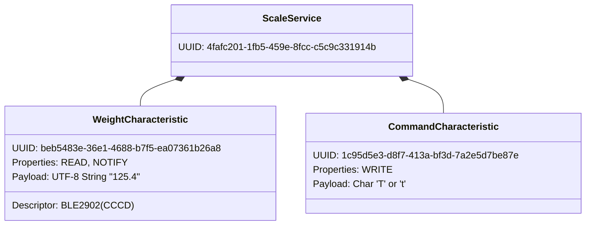
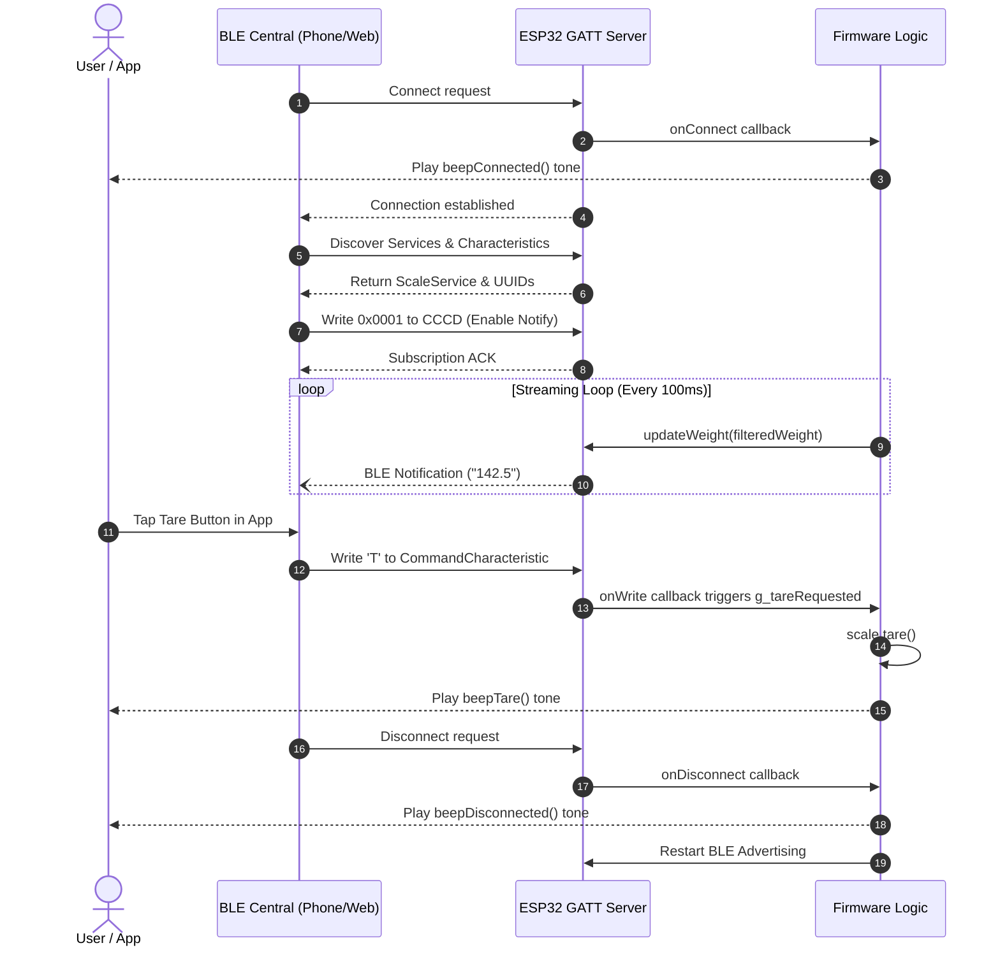

# Bluetooth Low Energy (BLE) GATT Specification

[← Back to Documentation Index](README.md) | [← Back to Root Repository](../README.md)

This document specifies the Bluetooth Low Energy (BLE) Generic Attribute Profile (GATT) architecture, service UUIDs, characteristic descriptors, data payloads, and interaction sequences for the SmartcaleESP32 scale.

---

## Profile Architecture

The scale functions as a BLE Peripheral operating as a GATT Server. The advertised device name defaults to `SmartKitchenScale` and can be customized via the web provisioning portal.

---

## Service Definition

- **Service Name**: Smart Scale Service
- **Service UUID**: `4fafc201-1fb5-459e-8fcc-c5c9c331914b`
- **Advertisement**: The Primary Service UUID is included in the BLE advertising payload and scan response packets.

---

## Characteristics

### 1. Weight Data Characteristic

Transmits live weight measurements from the scale to connected central devices.

| Parameter | Value |
| :--- | :--- |
| **UUID** | `beb5483e-36e1-4688-b7f5-ea07361b26a8` |
| **Permissions / Properties** | `READ`, `NOTIFY` |
| **Descriptors** | `0x2902` (Client Characteristic Configuration Descriptor / CCCD) |
| **Data Format** | UTF-8 encoded text string |
| **Numeric Precision** | 1 decimal place (tenths of a gram) |
| **Update Cadence** | Transmitted every 100ms when connected |
| **Payload Examples** | `"0.0"`, `"14.2"`, `"502.8"`, `"-5.1"` |

#### Client Notification Subscription
To receive automated streaming measurements, the BLE Central device must write `0x0001` to the CCCD descriptor (`0x2902`) associated with this characteristic.

### 2. Remote Command Characteristic

Accepts control instructions from connected clients to trigger scale actions.

| Parameter | Value |
| :--- | :--- |
| **UUID** | `1c95d5e3-d8f7-413a-bf3d-7a2e5d7be87e` |
| **Permissions / Properties** | `WRITE` |
| **Data Format** | Single ASCII / UTF-8 character |
| **Supported Opcodes** | `'T'` (0x54) or `'t'` (0x74) |
| **Action** | Triggers scale zeroing (tare) and generates an acoustic confirmation tone |

---

## Communication Sequence

---

## Connection Parameters

- **Advertising Interval**: 100ms default.
- **Preferred Connection Interval**: 20ms minimum to 40ms maximum.
- **Supervision Timeout**: 4000ms.
- **Auto-Advertising**: The firmware automatically restarts BLE advertising immediately after a client disconnects.
