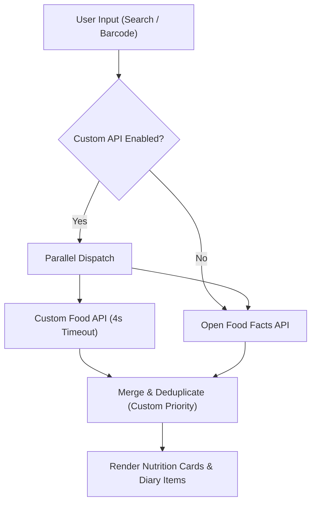

# Food Database & Hybrid Search Integration

[← Back to Documentation Index](README.md) | [← Back to Root Repository](../README.md)

The Smartcale Companion App features a built-in nutrition tracking system with **Hybrid Food Search**. By default, it queries the global [Open Food Facts](https://world.openfoodfacts.org/) database. Users can also connect their own custom food database or backend REST API directly through the mobile/web application settings without rebuilding or modifying the application code.

---

## Architecture & Search Flow

When a Custom API is configured and enabled in Settings:
1. **Parallel Execution**: Text searches query both the Custom API and Open Food Facts simultaneously.
2. **Prioritization**: Results from your Custom API are listed first.
3. **Deduplication**: Results sharing the same barcode or product code are deduplicated, keeping your custom product definition.
4. **Resilience & Fallback**:
   - If the Custom API fails, times out (4-second abort controller), or returns no matches, Open Food Facts results are returned seamlessly.
   - Barcode scans check your Custom API first; if unlisted, they fall back to Open Food Facts.



---

## App UI Configuration

To configure your database from the app:
1. Open the companion app in your browser or mobile device.
2. Open **Settings** (gear icon or bottom navigation).
3. Expand **Besin Veritabanı & Özel API (Food Database & Custom API)**.
4. Toggle **Özel API ile Hibrit Arama (Hybrid Search with Custom API)** to `ON`.
5. Enter your endpoint details:
   - **Custom API Base URL**: e.g., `https://api.yourdomain.com/v1/foods`
   - **API Key / Token (Optional)**: Bearer token or API key for protected endpoints.
6. Click **Bağlantıyı Test Et (Test Connection)** to verify connectivity and schema compatibility.
7. Settings persist in `localStorage` across sessions.

---

## REST API Specification

Your custom API backend should implement the following lightweight HTTP endpoints:

### 1. Product Search
- **Method**: `GET`
- **Path**: `{baseUrl}?q={query}&limit={limit}`
- **Query Parameters**:
  - `q`: Search keyword or barcode (string, URL-encoded).
  - `limit`: Maximum number of results requested (integer, default: 10).

#### Headers Received:
```http
Accept: application/json
Authorization: Bearer <your_token>   # If API Key was provided
X-API-Key: <your_token>              # If API Key was provided
```

#### Expected JSON Response:
The endpoint can return a direct JSON array, or an object containing an `items`, `products`, `data`, or `results` array.

Both **flat** and **nested** nutrient structures are automatically parsed:

##### Option A: Flat Nutrient Schema (Recommended for Simple Backends)
```json
[
  {
    "code": "8690123456789",
    "name": "Grilled Chicken Breast",
    "brand": "Homemade",
    "calories": 165.0,
    "protein": 31.0,
    "carbs": 0.0,
    "fat": 3.6,
    "imageUrl": "https://example.com/chicken.jpg"
  }
]
```

##### Option B: Nested Schema (Open Food Facts Compatible)
```json
[
  {
    "code": "8690123456789",
    "product_name": "Grilled Chicken Breast",
    "brands": "Homemade",
    "nutriments": {
      "calories100g": 165.0,
      "proteins100g": 31.0,
      "carbs100g": 0.0,
      "fat100g": 3.6
    }
  }
]
```

### 2. Barcode Lookup
- **Method**: `GET`
- **Path**: `{baseUrl}/{barcode}`
- **Response**: A single product JSON object (or `{ product: { ... } }` / `{ data: { ... } }`).
- **Not Found**: Return HTTP `404` or an empty object `{}` to trigger fallback to Open Food Facts.

---

## Example Backend Implementations

### Python (FastAPI)
```python
from fastapi import FastAPI, Header, HTTPException, Query
from typing import Optional, List

app = FastAPI(title="Smartcale Food API")

# Mock database
FOOD_DB = [
    {
        "code": "8690001",
        "name": "Oatmeal with Honey",
        "brand": "My Kitchen",
        "calories": 360.0,
        "protein": 13.0,
        "carbs": 68.0,
        "fat": 6.0
    },
    {
        "code": "8690002",
        "name": "Whey Protein Shake",
        "brand": "My Kitchen",
        "calories": 120.0,
        "protein": 24.0,
        "carbs": 3.0,
        "fat": 1.5
    }
]

@app.get("/foods")
def search_foods(q: str = Query(..., min_length=1), limit: int = 10, authorization: Optional[str] = Header(None)):
    query = q.lower().strip()
    matches = [f for f in FOOD_DB if query in f["name"].lower() or query in f["code"]]
    return matches[:limit]

@app.get("/foods/{barcode}")
def get_by_barcode(barcode: str, authorization: Optional[str] = Header(None)):
    for f in FOOD_DB:
        if f["code"] == barcode:
            return f
    raise HTTPException(status_code=404, detail="Product not found")
```

### Node.js (Express)
```javascript
const express = require('express');
const cors = require('cors');
const app = express();
app.use(cors());
app.use(express.json());

const FOODS = [
  { code: '8690001', name: 'Oatmeal with Honey', calories: 360, protein: 13, carbs: 68, fat: 6 },
  { code: '8690002', name: 'Whey Protein Shake', calories: 120, protein: 24, carbs: 3, fat: 1.5 },
];

app.get('/foods', (req, res) => {
  const q = (req.query.q || '').toLowerCase().trim();
  const limit = parseInt(req.query.limit, 10) || 10;
  const matches = FOODS.filter(f => f.name.toLowerCase().includes(q) || f.code.includes(q));
  res.json(matches.slice(0, limit));
});

app.get('/foods/:barcode', (req, res) => {
  const item = FOODS.find(f => f.code === req.params.barcode);
  if (!item) return res.status(404).json({ error: 'Not found' });
  res.json(item);
});

app.listen(3000, () => console.log('Food API listening on port 3000'));
```
