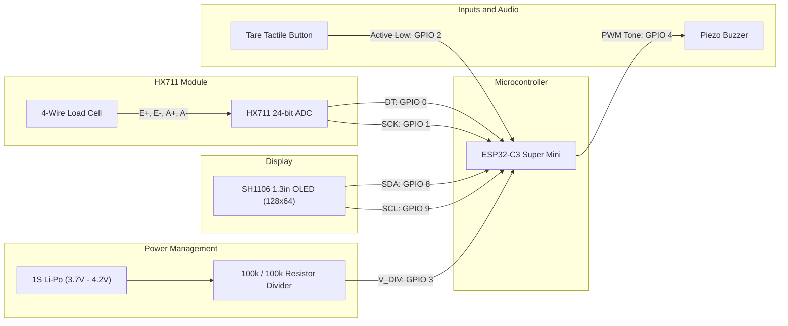

# Hardware Specification & Wiring

[← Back to Documentation Index](README.md) | [← Back to Root Repository](../README.md)

This document specifies the hardware architecture, pin assignments, electrical constraints, and peripheral hookups for the SmartcaleESP32 kitchen scale.

---

## Microcontroller: ESP32-C3 Super Mini

The board is powered by an Espressif ESP32-C3FH4 single-core 32-bit RISC-V processor clocked at 160MHz with 400KB SRAM and 4MB integrated flash. It features on-chip 2.4GHz Wi-Fi (802.11 b/g/n) and Bluetooth 5 (LE).

### Pin Allocation Map

| ESP32-C3 Pin | Peripheral | Signal Name | I/O Mode | Electrical Characteristics |
| :--- | :--- | :--- | :--- | :--- |
| **GPIO 0** | HX711 ADC | DT (Data) | Input | High-impedance digital input |
| **GPIO 1** | HX711 ADC | SCK (Clock) | Output | Push-pull digital output |
| **GPIO 2** | Tactile Switch | Tare Button | Input | Internal pull-up enabled, active low to GND |
| **GPIO 3** | Voltage Divider | Battery Sense | Analog Input | ADC1 Channel 3, 11dB attenuation (up to 2.5V) |
| **GPIO 4** | Piezo Buzzer | PWM Signal | Output | LEDC PWM driven tone generator |
| **GPIO 8** | SH1106 OLED | SDA | Open-Drain / I2C | Hardware I2C data bus |
| **GPIO 9** | SH1106 OLED | SCL | Open-Drain / I2C | Hardware I2C clock bus (400kHz) |

---

## Wiring Diagram

---

## Subsystem Details

### 1. HX711 Load Cell Interface

The HX711 is a precision 24-bit analog-to-digital converter designed for weigh scales. It interfaces with a four-wire Wheatstone bridge strain gauge load cell.

- **Excitation & Signal Lines**:
  - `E+` (Excitation Positive): Connected to HX711 `E+` (or `VCC`).
  - `E-` (Excitation Negative): Connected to HX711 `E-` (or `GND`).
  - `A+` (Signal Positive): Connected to HX711 `A+`.
  - `A-` (Signal Negative): Connected to HX711 `A-`.
- **Logic Level**: Operates from 3.3V or 5.0V. The ESP32-C3 inputs are not 5V-tolerant. When supplying 5V to the HX711 board, confirm that DT line output does not exceed 3.6V, or power the HX711 directly from the 3.3V rail.
- **Sample Rate**: The module defaults to 10Hz or 80Hz depending on the HX711 `RATE` pin state. Grounding `RATE` sets 10Hz sampling. Tying `RATE` to VCC enables 80Hz high-speed acquisition.

### 2. SH1106 128x64 Monochrome OLED

Display rendering uses the U8g2 library with the full-buffer constructor `U8G2_SH1106_128X64_NONAME_F_HW_I2C`.

- **Bus Configuration**: Hardware I2C on GPIO 8 (SDA) and GPIO 9 (SCL).
- **Clock Frequency**: Initialized at 400kHz for low screen latency.
- **Pull-Up Resistors**: The OLED breakout board typically includes onboard 4.7k Ohm pull-up resistors to 3.3V. If using a bare panel without onboard pull-ups, install external 4.7k Ohm resistors between SDA/SCL and 3.3V.

### 3. Battery Voltage Divider

Battery monitoring measures a single-cell lithium polymer battery with a nominal voltage of 3.7V and a maximum charging voltage of 4.2V.

- **Divider Circuit**:
  - High-side resistor: 100k Ohm connected from battery positive to GPIO 3.
  - Low-side resistor: 100k Ohm connected from GPIO 3 to GND.
  - Scaling ratio: 
    $$V_{\text{ADC}} = V_{\text{BAT}} \times \frac{100\,\text{k}\Omega}{100\,\text{k}\Omega + 100\,\text{k}\Omega} = \frac{V_{\text{BAT}}}{2}$$
- **Maximum ADC Input**: At $V_{\text{BAT}} = 4.2\text{V}$, $V_{\text{ADC}} = 2.1\text{V}$.
- **ADC Configuration**: ADC1 Channel 3 configured with 11dB attenuation (`ADC_11db`). This configuration scales the measurable range up to approximately 2500mV, well above the 2100mV peak.

### 4. Tare Button

- **Switch Type**: Normally-open momentary tactile pushbutton.
- **Connection**: One terminal connects to GPIO 2. The opposite terminal connects to GND.
- **Configuration**: Internal pull-up (`INPUT_PULLUP`). The pin remains logic HIGH when open and drops to logic LOW when pressed.
- **Interrupt Mode**: Hardware interrupt configured for `FALLING` edges with a 200ms debounce interval in software.

### 5. Piezo Buzzer

- **Type**: Passive or active piezo transducer.
- **Connection**: Positive terminal to GPIO 4, negative terminal to GND.
- **Drive Mode**: Driven through the ESP32 hardware LEDC peripheral via the non-blocking Arduino `tone()` function. Frequency patterns vary from 1200Hz to 2400Hz depending on system events.
