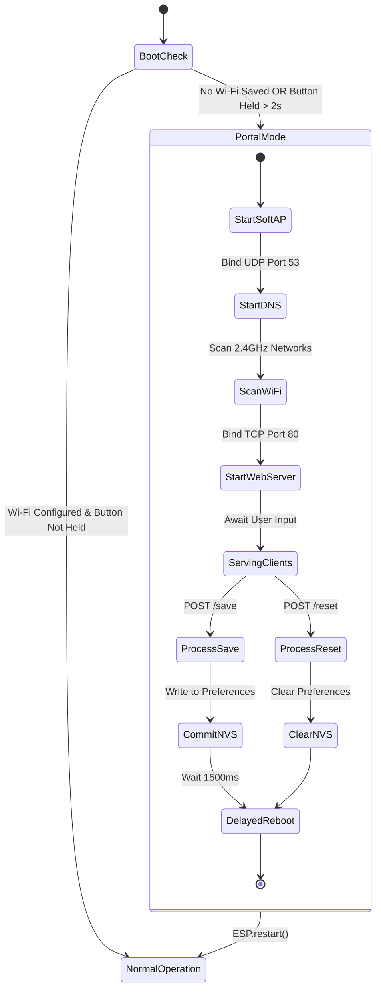

# Wi-Fi Provisioning & Captive Portal

[← Back to Documentation Index](README.md) | [← Back to Root Repository](../README.md)

This document describes the captive portal provisioning system, SoftAP wireless network configuration, HTTP endpoints, DNS hijacking mechanics, and non-volatile storage (NVS) layout.

---

## Provisioning Architecture

When unconfigured or explicitly commanded by the user, the ESP32-C3 initiates a Wi-Fi Access Point (SoftAP) and launches an internal DNS and HTTP server. Client devices connecting to this access point are redirected to the configuration web interface.

---

## Activation Conditions

1. **First Boot (Automated)**:
   The firmware inspects NVS storage on startup. If no Wi-Fi SSID is stored (`storage.isConfigured() == false`), the device enters portal mode directly.
2. **Manual Button Hold**:
   During power-up, holding the physical Tare button (GPIO 2) for more than 2.0 seconds forces portal mode.

---

## Network & DNS Hijacking

### SoftAP Configuration
- **SSID**: `SmartScale-Setup`
- **Security**: Open (No WPA passphrase required for initial setup)
- **Local IP**: `192.168.4.1`
- **Subnet Mask**: `255.255.255.0`

### DNS Captive Portal Redirection
A lightweight DNS server listens on UDP port 53. It replies to every inbound domain query with the scale IP address (`192.168.4.1`). Operating systems detecting captive networks automatically open the login browser window.

### Captive Probe Endpoints
The embedded web server intercepts operating-system specific connectivity check requests and returns HTTP 302 redirects to `http://192.168.4.1/`:

| Probe Path | Target Operating System | Response Code | Action |
| :--- | :--- | :--- | :--- |
| `/hotspot-detect.html` | Apple iOS / macOS | 302 Found | Redirects to `/` |
| `/generate_204` | Google Android / Chromium | 302 Found | Redirects to `/` |
| `/ncsi.txt` | Microsoft Windows | 302 Found | Redirects to `/` |
| `/connecttest.txt` | Microsoft Windows | 302 Found | Redirects to `/` |
| `/*` (Catch-all) | Any unrecognized route | 302 Found | Redirects to `/` |

---

## Web Server API Endpoints

### 1. `GET /`
Renders the complete mobile-responsive HTML configuration page.

- **Dynamic Content**: Injects a live list of scanned 2.4GHz Wi-Fi networks sorted into an interactive select element.
- **Form Controls**:
  - Wi-Fi SSID selection or manual text override.
  - Wi-Fi WPA2 passphrase input.
  - Custom BLE device name input.
  - Load cell calibration factor floating point input.
  - Save Settings submit button.
  - Factory Reset submit button.

### 2. `POST /save`
Processes submitted configuration parameters:

- Validates and sanitizes incoming fields: `ssid`, `password`, `ble_name`, `cal_factor`.
- Commits values to non-volatile flash storage using ESP32 Preferences API.
- Renders a confirmation page indicating impending restart.
- Arm an asynchronous 1500ms software timer before triggering `ESP.restart()`.

### 3. `POST /reset`
Executes factory wipe:

- Clears all keys stored under the `"smartscale"` NVS namespace.
- Renders a factory reset confirmation page.
- Triggers `ESP.restart()` after 1500ms.

---

## NVS Storage Schema

Parameters persist across power cycles using the ESP32 Preferences flash storage library under namespace `"smartscale"`:

| Preference Key | Data Type | Maximum Length | Default Value | Description |
| :--- | :--- | :--- | :--- | :--- |
| `wifi_ssid` | String | 32 characters | `""` | Target Wi-Fi network SSID |
| `wifi_pass` | String | 64 characters | `""` | WPA/WPA2/WPA3 network password |
| `ble_name` | String | 32 characters | `"SmartKitchenScale"` | Advertised BLE device name |
| `cal_factor` | Float | 4 bytes (IEEE 754) | `420.0f` | Load cell ADC to gram scaling divisor |
